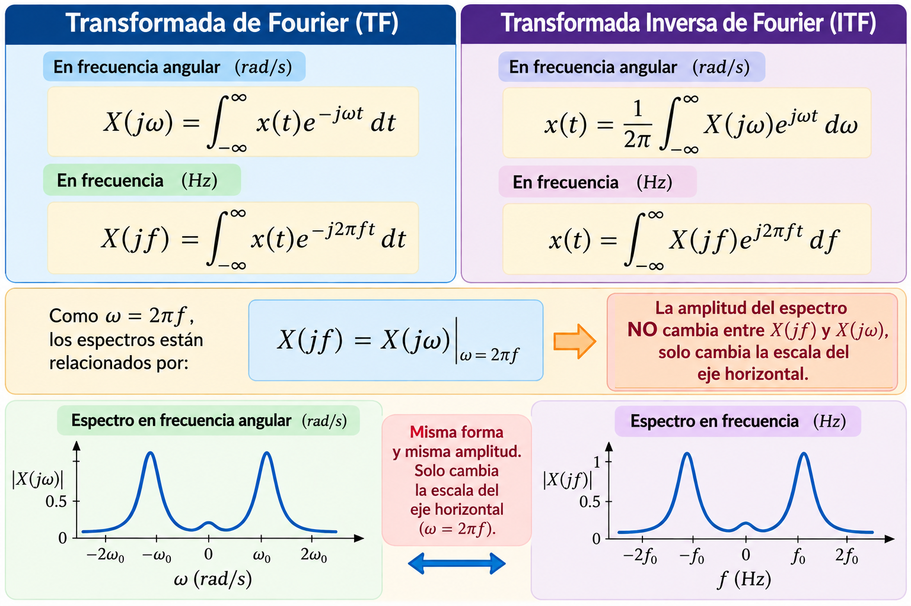
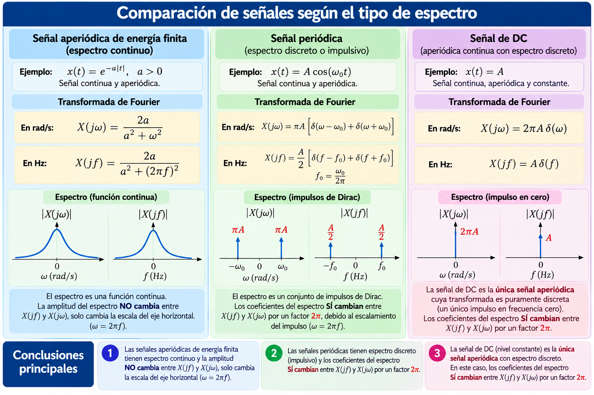
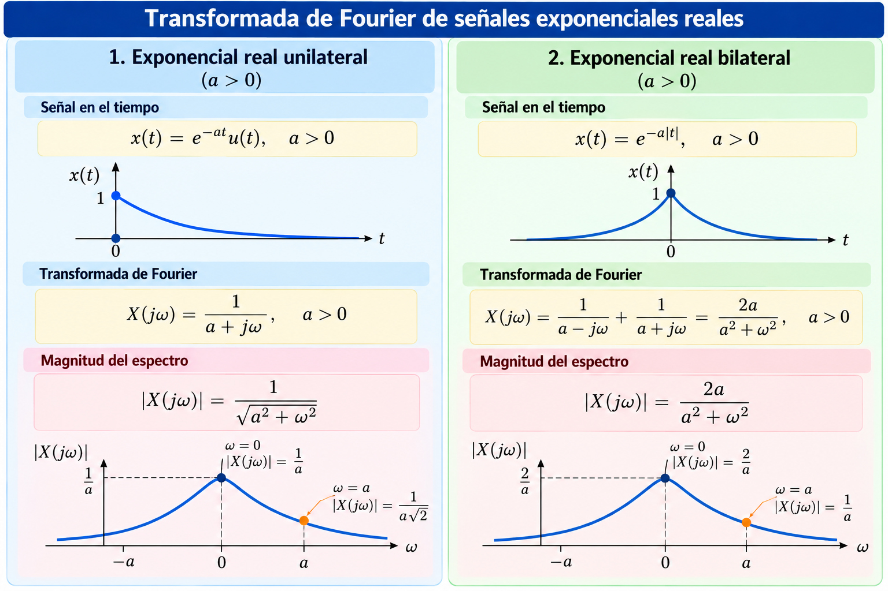
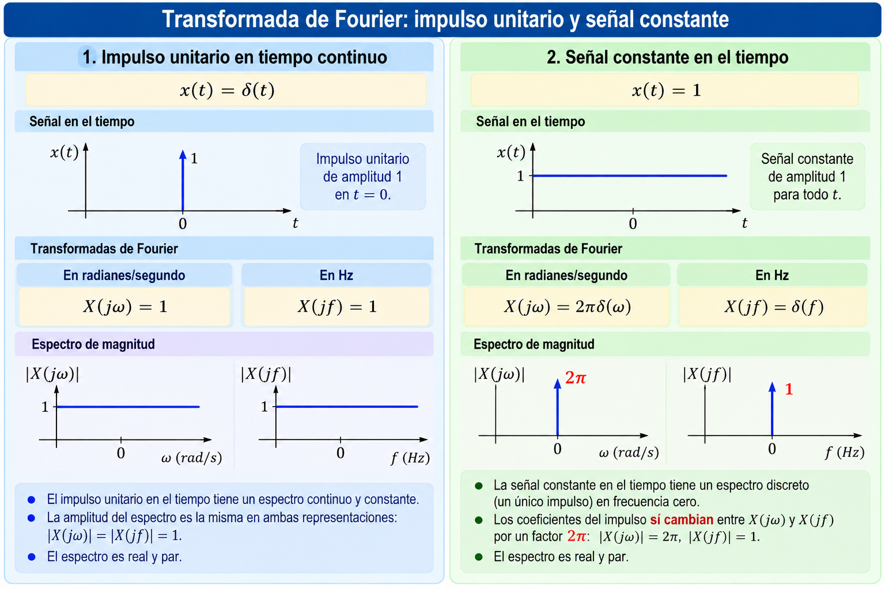

# 📡 Transformada de Fourier de señales aperiódicas

## 1. Transformada de Fourier y Transformada Inversa de Fourier

A diferencia de las señales periódicas, cuyo espectro está formado por impulsos en frecuencias armónicas, las **señales aperiódicas de energía finita** presentan, en general, un espectro no impulsivo. La Transformada de Fourier (TF) permite representar estas señales en el dominio de la frecuencia.

La TF puede expresarse en función de la frecuencia angular $\omega$ (rad/s) o de la frecuencia $f$ (Hz):

$$
X(j\omega)=\int_{-\infty}^{\infty}x(t)e^{-j\omega t}\,dt
$$

$$
X(jf)=\int_{-\infty}^{\infty}x(t)e^{-j2\pi ft}\,dt
$$

La Transformada Inversa de Fourier (ITF) permite recuperar la señal temporal:

$$
x(t)=\frac{1}{2\pi}\int_{-\infty}^{\infty}X(j\omega)e^{j\omega t}\,d\omega
$$

$$
x(t)=\int_{-\infty}^{\infty}X(jf)e^{j2\pi ft}\,df
$$

Como $\omega=2\pi f$, se cumple:

$$
\boxed{X(jf)=X(j\omega)\big|_{\omega=2\pi f}}
$$

**Para un espectro representado por una función ordinaria, su amplitud no cambia entre $X(j\omega)$ y $X(jf)$; únicamente cambia la escala del eje horizontal.**

---

## 2. Espectros continuos e impulsivos

Es importante distinguir entre los espectros descritos mediante funciones ordinarias y aquellos que contienen **impulsos de Dirac**.

- **Señales aperiódicas de energía finita:** su TF no contiene impulsos de Dirac y, en los ejemplos habituales, se representa mediante una curva continua.
- **Señales periódicas:** su TF está formada por impulsos de Dirac ubicados en las frecuencias armónicas.
- **Señal constante o nivel DC:** su TF contiene un único impulso de Dirac en frecuencia cero. Aunque no posee período fundamental, también puede entenderse como una señal periódica con cualquier período positivo.

Para las componentes impulsivas, el escalamiento de la delta de Dirac introduce un factor $2\pi$ entre los coeficientes expresados en rad/s y en Hz. Esta diferencia **no** se aplica a la amplitud de las partes espectrales representadas mediante funciones ordinarias.

---

## 3. Transformada de Fourier de señales exponenciales reales

### Ejemplo 34. Exponencial real unilateral

Consideremos la señal:

$$
x(t)=e^{-at}u(t),\qquad a>0
$$

Su Transformada de Fourier en frecuencia angular es:

$$
X(j\omega)=\int_0^{\infty}e^{-at}e^{-j\omega t}\,dt
=\int_0^{\infty}e^{-(a+j\omega)t}\,dt
$$

$$
X(j\omega)=\left[\frac{e^{-(a+j\omega)t}}{-(a+j\omega)}\right]_0^{\infty}
=\boxed{\frac{1}{a+j\omega}}
$$

La magnitud del espectro es:

$$
\boxed{|X(j\omega)|=\frac{1}{\sqrt{a^2+\omega^2}}}
$$

Dos valores permiten caracterizar su comportamiento:

$$
|X(j0)|=\frac{1}{a},\qquad
|X(ja)|=\frac{1}{a\sqrt{2}}
$$

El espectro de magnitud es par y alcanza su valor máximo en $\omega=0$. La TF, sin embargo, es compleja en general.

### Ejemplo 35. Exponencial real bilateral

Consideremos ahora la señal:

$$
x(t)=e^{-a|t|},\qquad a>0
$$

Equivalentemente:

$$
x(t)=\begin{cases}
e^{at},&t<0\\
e^{-at},&t\geq0
\end{cases}
$$

Su TF se obtiene separando las integrales para tiempos negativos y positivos:

$$
X(j\omega)=\int_{-\infty}^{0}e^{at}e^{-j\omega t}\,dt
+\int_0^{\infty}e^{-at}e^{-j\omega t}\,dt
$$

$$
X(j\omega)=\frac{1}{a-j\omega}+\frac{1}{a+j\omega}
=\boxed{\frac{2a}{a^2+\omega^2}}
$$

En este caso, el espectro es **real, par y no negativo**, por lo que:

$$
\boxed{|X(j\omega)|=\frac{2a}{a^2+\omega^2}}
$$

Sus valores característicos son:

$$
|X(j0)|=\frac{2}{a},\qquad
|X(ja)|=\frac{1}{a}
$$

La siguiente figura compara las señales temporales y los espectros de magnitud de ambas exponenciales.

---

## 4. Transformada de Fourier del impulso unitario y de una señal constante

### Ejemplo 36. Impulso unitario en tiempo continuo

Sea:

$$
x(t)=\delta(t)
$$

Aplicando la propiedad de muestreo del impulso de Dirac:

$$
X(j\omega)=\int_{-\infty}^{\infty}\delta(t)e^{-j\omega t}\,dt=\boxed{1}
$$

De igual manera, en Hz:

$$
\boxed{X(jf)=1}
$$

El impulso en el tiempo tiene un **espectro constante e igual a 1** en ambas representaciones de frecuencia.

### Ejemplo 37. Señal constante en el tiempo (nivel DC)

Sea:

$$
x(t)=1
$$

Su Transformada de Fourier en frecuencia angular es:

$$
\boxed{X(j\omega)=2\pi\delta(\omega)}
$$

En frecuencia ordinaria:

$$
\boxed{X(jf)=\delta(f)}
$$

El espectro está formado por **un único impulso en frecuencia cero**. Los coeficientes que acompañan al impulso son $2\pi$ en rad/s y $1$ en Hz, debido a la propiedad de escalamiento de la delta de Dirac. Estos coeficientes representan el peso del impulso, no una altura finita de la función delta.

La figura muestra las dos señales temporales y sus espectros expresados tanto en Hz como en rad/s.

---

## 🎯 Conclusiones

- La TF y la ITF pueden formularse utilizando frecuencia angular $\omega$ (rad/s) o frecuencia ordinaria $f$ (Hz).
- En los **espectros ordinarios**, la relación $\omega=2\pi f$ modifica la escala horizontal, **no la amplitud**.
- La exponencial unilateral $e^{-at}u(t)$ tiene $X(j\omega)=1/(a+j\omega)$ y magnitud $1/\sqrt{a^2+\omega^2}$.
- La exponencial bilateral $e^{-a|t|}$ tiene $X(j\omega)=2a/(a^2+\omega^2)$, un espectro real y par.
- El impulso unitario $\delta(t)$ tiene espectro constante: $X(j\omega)=X(jf)=1$.
- La señal constante $x(t)=1$ tiene espectro impulsivo: $X(j\omega)=2\pi\delta(\omega)$ y $X(jf)=\delta(f)$.
- **En los espectros impulsivos cambian los coeficientes de los impulsos por un factor $2\pi$** al pasar de Hz a rad/s.

**La diferencia esencial no es únicamente si la señal es periódica o aperiódica, sino si su espectro se representa mediante una función ordinaria o contiene impulsos de Dirac.**
