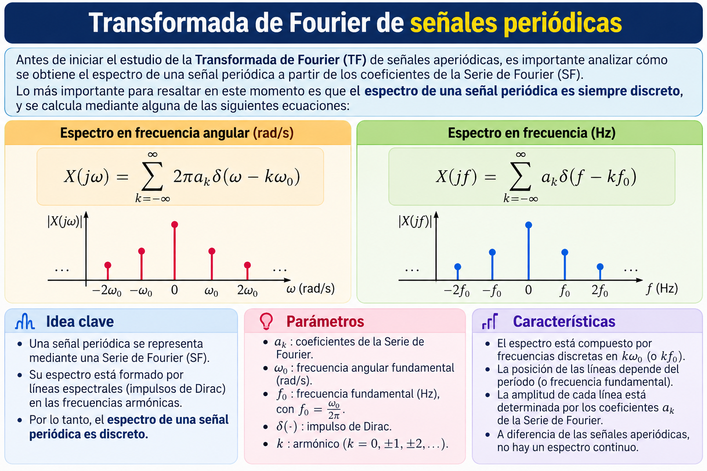
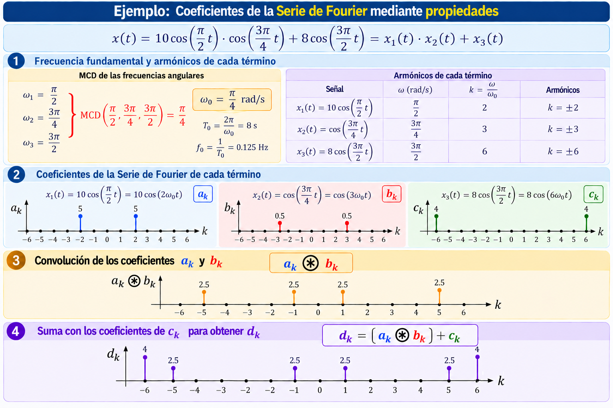
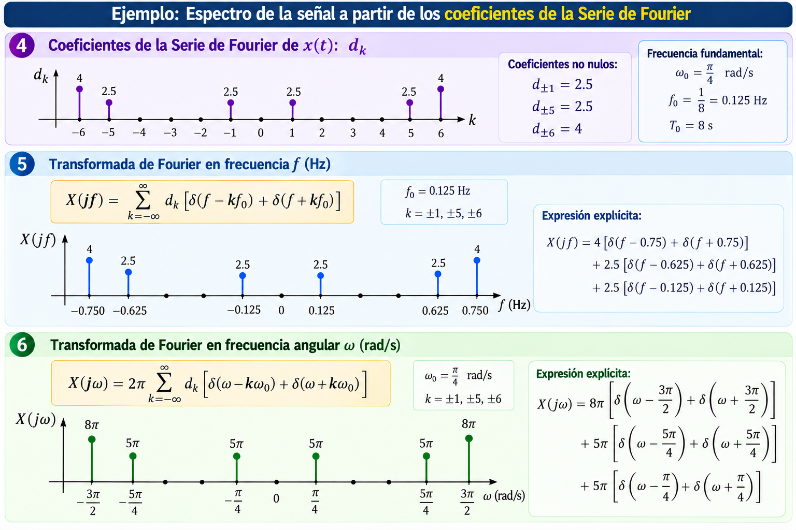

# 📡 Transformada de Fourier de señales periódicas

## 1. Relación entre la Serie de Fourier y la Transformada de Fourier

Antes de estudiar la Transformada de Fourier (TF) de señales aperiódicas, es importante comprender cómo se obtiene el espectro de una señal periódica a partir de los coeficientes de su Serie de Fourier (SF).

La característica fundamental es que **el espectro de una señal periódica es discreto**, formado por impulsos de Dirac ubicados en las frecuencias armónicas.

La Transformada de Fourier puede expresarse en función de la frecuencia angular $\omega$ (rad/s) o de la frecuencia $f$ (Hz):

$$
X(j\omega)=\sum_{k=-\infty}^{\infty}2\pi a_k\delta(\omega-k\omega_0)
$$

$$
X(jf)=\sum_{k=-\infty}^{\infty}a_k\delta(f-kf_0)
$$

Donde:

- $a_k$: coeficientes de la Serie de Fourier.
- $\omega_0$: frecuencia angular fundamental (rad/s).
- $f_0$: frecuencia fundamental (Hz).
- $k$: índice armónico.
- $\delta(\cdot)$: impulso de Dirac.

---

## 2. Ejemplo: cálculo de los coeficientes de la Serie de Fourier

Consideremos la señal:

$$
x(t)=10\cos\left(\frac{\pi}{2}t\right)\cos\left(\frac{3\pi}{4}t\right)+8\cos\left(\frac{3\pi}{2}t\right)
$$

La expresamos como:

$$
x(t)=x_1(t)x_2(t)+x_3(t)
$$

### Paso 1. Frecuencia fundamental y armónicos

Las frecuencias angulares de los tres términos son:

$$
\omega_1=\frac{\pi}{2},\quad
\omega_2=\frac{3\pi}{4},\quad
\omega_3=\frac{3\pi}{2}
$$

Calculamos la frecuencia angular fundamental utilizando el máximo común divisor (MCD):

$$
\omega_0=\frac{\pi}{4}\mathrm{MCD}(2,3,6)
=\boxed{\frac{\pi}{4}\text{ rad/s}}
$$

Por tanto:

$$
T_0=\frac{2\pi}{\omega_0}=8\text{ s}
$$

$$
f_0=\frac{1}{T_0}=0.125\text{ Hz}
$$

Los armónicos correspondientes son:

| Señal | Armónicos |
|---|---|
| $x_1(t)=10\cos(2\omega_0t)$ | $k=\pm2$ |
| $x_2(t)=\cos(3\omega_0t)$ | $k=\pm3$ |
| $x_3(t)=8\cos(6\omega_0t)$ | $k=\pm6$ |

### Paso 2. Coeficientes de la Serie de Fourier

Denominamos $a_k$, $b_k$ y $c_k$ a los coeficientes de $x_1(t)$, $x_2(t)$ y $x_3(t)$, respectivamente.

Los coeficientes no nulos son:

$$
a_{\pm2}=5,\qquad
b_{\pm3}=0.5,\qquad
c_{\pm6}=4
$$

### Paso 3. Propiedad de multiplicación

La multiplicación de dos señales periódicas en el dominio temporal corresponde a la convolución discreta de sus coeficientes de la Serie de Fourier:

$$
(a*b)_k=\sum_{m=-\infty}^{\infty}a_m b_{k-m}
$$

Las combinaciones de armónicos son:

$$
(+2)+(+3)=+5
$$

$$
(+2)+(-3)=-1
$$

$$
(-2)+(+3)=+1
$$

$$
(-2)+(-3)=-5
$$

Cada coeficiente resultante tiene amplitud:

$$
5(0.5)=2.5
$$

### Paso 4. Propiedad de linealidad

Incorporamos los coeficientes de $x_3(t)$:

$$
\boxed{d_k=(a*b)_k+c_k}
$$

Obtenemos:

$$
\boxed{
d_{\pm1}=2.5,\qquad
d_{\pm5}=2.5,\qquad
d_{\pm6}=4
}
$$

La siguiente figura presenta gráficamente el cálculo completo de los coeficientes mediante las propiedades de multiplicación y linealidad.

---

## 3. Transformada de Fourier de la señal periódica

Una vez calculados los coeficientes $d_k$, podemos construir el espectro de la señal.

### Paso 5. Transformada de Fourier en frecuencia (Hz)

Utilizamos:

$$
X(jf)=\sum_{k=-\infty}^{\infty}d_k\delta(f-kf_0)
$$

Las posiciones de los impulsos corresponden a $kf_0$, mientras que sus amplitudes son iguales a los coeficientes $d_k$.

Como $f_0=0.125$ Hz:

| Armónicos | Frecuencia (Hz) | Amplitud |
|---|---|---|
| $k=\pm1$ | $\pm0.125$ | 2.5 |
| $k=\pm5$ | $\pm0.625$ | 2.5 |
| $k=\pm6$ | $\pm0.750$ | 4 |

### Paso 6. Transformada de Fourier en frecuencia angular (rad/s)

Utilizamos:

$$
X(j\omega)=2\pi\sum_{k=-\infty}^{\infty}d_k\delta(\omega-k\omega_0)
$$

Las posiciones de los impulsos corresponden a $k\omega_0$, mientras que sus amplitudes son $2\pi d_k$.

Como $\omega_0=\pi/4$ rad/s:

| Armónicos | Frecuencia angular (rad/s) | Amplitud |
|---|---|---|
| $k=\pm1$ | $\pm\pi/4$ | $5\pi$ |
| $k=\pm5$ | $\pm5\pi/4$ | $5\pi$ |
| $k=\pm6$ | $\pm3\pi/2$ | $8\pi$ |

La siguiente figura muestra la relación entre los coeficientes de la Serie de Fourier y los espectros obtenidos en Hz y rad/s.

---

## 🎯 Conclusiones

- El espectro de una señal periódica está formado por impulsos de Dirac ubicados en las frecuencias armónicas.
- La propiedad de multiplicación de la Serie de Fourier permite calcular los coeficientes mediante convolución discreta.
- La propiedad de linealidad permite sumar los coeficientes de las señales que conforman la señal resultante.
- En $X(jf)$, las posiciones de los impulsos son $kf_0$ y sus amplitudes son $d_k$.
- En $X(j\omega)$, las posiciones de los impulsos son $k\omega_0$ y sus amplitudes son $2\pi d_k$.

**La Transformada de Fourier de una señal periódica puede obtenerse directamente a partir de los coeficientes de su Serie de Fourier.**
