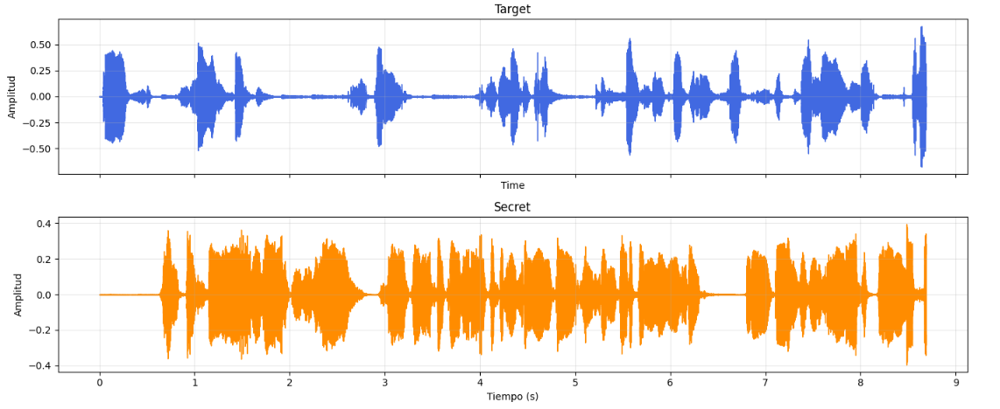
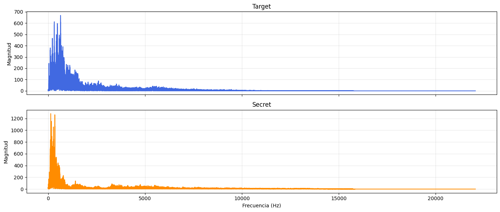
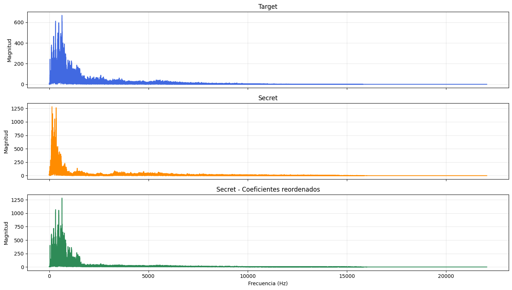
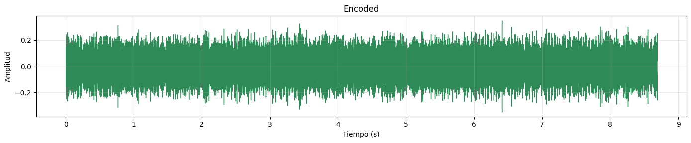

# 🎧 Proyecto de Análisis de Señales
## 🔐 Ocultamiento y recuperación de mensajes mediante permutación espectral

### 🎯 Objetivo

Desarrollar un procedimiento de **codificación espectral (*Imitation*)** que permita ocultar cinco mensajes de audio mediante la reorganización de sus coeficientes de Fourier. Posteriormente, recuperar los mensajes con el procedimiento **Reverse**, proporcionado por la profesora, y evaluar cuantitativamente la calidad de las señales reconstruidas.

El procedimiento debe trabajar con **coeficientes espectrales complejos completos** (parte real e imaginaria), no únicamente con sus magnitudes. El audio codificado puede percibirse como ruido, aunque debe conservar la información necesaria para recuperar el mensaje secreto.

## 🧩 Parte I. Imitation — Desarrollo del estudiante

### 🎙️ 1. Carga y exploración temporal

Cargar el audio de referencia (**Target**) y uno de los audios secretos (**Secret**). Verificar que ambos tengan la misma frecuencia de muestreo y cantidad de muestras. Representar las dos señales en el dominio temporal y escucharlas.



**🔎 Analiza:** ¿cómo difieren las señales en amplitud, pausas y distribución temporal de la actividad?

### 📊 2. Análisis espectral

Calcular los coeficientes espectrales de ambas señales mediante **`rfft`** y representar sus espectros de magnitud en función de la frecuencia (Hz).



**🔎 Analiza:** identifica las regiones de mayor magnitud y compara la ubicación de los picos principales. Recuerda que cada coeficiente de `rfft` contiene información de magnitud y fase.


### 🔀 3. Reorganización de coeficientes complejos

Diseña una permutación que reorganice los coeficientes espectrales complejos del **Secret**, tomando como referencia el orden de magnitudes de los coeficientes del **Target**.

Para ello:

1. Identifica las posiciones de los coeficientes de ambas señales, ordenadas de menor a mayor magnitud.
2. Establece una correspondencia entre las posiciones que ocupan el mismo rango en ambos ordenamientos.
3. Construye una **clave de permutación** que permita reorganizar los coeficientes y posteriormente recuperar sus posiciones originales.
4. Reorganiza los **coeficientes complejos completos** del secreto, conservando conjuntamente sus partes real e imaginaria.

#### 🔑 Permutación espectral y creación de la clave

El procedimiento se representa mediante el siguiente pseudocódigo:

```python
I1 = argsort(abs(S[P]))
I2 = argsort(abs(T[P]))

K = identity_indices
K[P[I2]] = P[I1]

E = S[K]
```

**Donde:**

- **`S`**: coeficientes espectrales complejos del Secret.
- **`T`**: coeficientes espectrales complejos del Target.
- **`P`**: posiciones de los coeficientes que pueden permutarse.
- **`I1`**: índices que ordenan las magnitudes del Secret dentro de `P`.
- **`I2`**: índices que ordenan las magnitudes del Target dentro de `P`.
- **`K`**: clave de permutación que relaciona las posiciones originales del secreto con las posiciones del espectro reorganizado.
- **`E`**: espectro obtenido después de reorganizar los coeficientes complejos del Secret.
- **`identity_indices`**: vector de índices consecutivos que inicialmente mantiene cada coeficiente en su posición original.

> 📌 **Importante:** el coeficiente DC y, cuando el número de muestras es par, el coeficiente de Nyquist deben permanecer fijos. La permutación se aplica únicamente a las posiciones restantes y conserva tanto la parte real como la imaginaria de cada coeficiente.

#### 📊 Resultado esperado

La siguiente figura muestra cómo la reorganización modifica la distribución espectral del Secret, de manera que sus picos principales se ubican en posiciones similares a las del Target, sin modificar los valores de los coeficientes originales.




**🔎 Analiza:** explica por qué el espectro reorganizado presenta sus picos en posiciones semejantes a las del Target, aunque conserva las magnitudes de los coeficientes originales del Secret.


### 🔊 4. Generación del audio codificado

Aplica **`irfft`** al espectro complejo reorganizado para obtener la señal **Encoded**. Represéntala en el dominio temporal y escúchala. El resultado puede sonar como ruido o como un mensaje ininteligible.

La siguiente figura muestra un ejemplo de la señal codificada. Observa cómo su estructura temporal es diferente de las señales originales y presenta una actividad distribuida a lo largo de prácticamente toda su duración.



💾 Guarda el audio codificado como `encoded.wav` y su clave de permutación como `FFT_key.csv`. Asegúrate de que la convención utilizada para construir la clave sea compatible con el código **Reverse** proporcionado.


### 🎵 5. Repetición con cinco secretos

Repetir el procedimiento utilizando **los cinco audios secretos suministrados** y el mismo Target. Generar **cinco audios codificados y cinco claves**, evitando sobrescribir los resultados de cada caso. Identificar claramente los archivos mediante nombres diferenciados.

## 🔓 Parte II. Reverse — Código suministrado

Utilizar el procedimiento **Reverse** proporcionado por la profesora para recuperar cada mensaje a partir de su audio codificado y de la clave correspondiente.

Verificar mediante escucha que los **cinco mensajes secretos recuperados** sean inteligibles. Conservar el código utilizado y los cinco archivos de audio recuperados.

## 📏 Parte III. Evaluación de la calidad

Compara cada audio secreto original, $x[n]$, con su reconstrucción, $\hat{x}[n]$, mediante **dos métricas**:

**1. Relación señal a ruido de reconstrucción (SNR):**

$$
SNR = 10 \log_{10}
\left(
\frac{\sum_{n=0}^{N-1} x[n]^2}
{\sum_{n=0}^{N-1} (x[n]-\hat{x}[n])^2}
\right)
$$

**2. Coeficiente de correlación de Pearson:**

$$
\rho = \frac{\mathrm{Cov}(x,\hat{x})}
{\sigma_x \sigma_{\hat{x}}}
$$

**Donde:**

- $x[n]$: señal secreta original.
- $\hat{x}[n]$: señal secreta recuperada.
- $N$: número de muestras.
- $\sigma_x$: desviación estándar del secreto original.
- $\sigma_{\hat{x}}$: desviación estándar del secreto recuperado.

📌 **Interpretación:**

- **SNR (dB):** valores mayores indican menor error de reconstrucción.
- **Correlación de Pearson:** valores cercanos a 1 indican mayor similitud entre las formas de onda.

Calcular ambas métricas para los cinco mensajes y presentar los resultados en una tabla:

| Mensaje secreto | SNR (dB) | Correlación de Pearson |
|---|---:|---:|
| Secret 1 | | |
| Secret 2 | | |
| Secret 3 | | |
| Secret 4 | | |
| Secret 5 | | |

**🔎 Análisis requerido:** identifica qué mensaje obtuvo la mejor calidad de recuperación, determina si los cinco resultados son similares o si alguno presenta una diferencia considerable y propón explicaciones. Interpreta **ambas métricas**, no solo sus valores máximos. Explica por qué una permutación matemáticamente reversible puede presentar pequeños errores después de guardar y volver a cargar un audio digital.

## 🐙 Entrega en GitHub

Cada grupo deberá publicar el trabajo en un repositorio de la **cuenta personal de GitHub** de uno de sus integrantes. El repositorio deberá contener:

- Código desarrollado de **Imitation**, cinco audios `encoded` y sus cinco claves.
- Código **Reverse** proporcionado y cinco audios secretos recuperados.
- Código utilizado para calcular **SNR** y **correlación de Pearson**.
- Tabla de resultados y análisis comparativo en el `README.md`.

La entrega se formaliza mediante el enlace al repositorio con todos los archivos solicitados.

## 📋 Evaluación y condiciones

**🏅 Calidad:** la calificación dependerá del funcionamiento de los procedimientos, la calidad de los cinco mensajes recuperados y el análisis de resultados.

**⏱️ Oportunidad:** la **primera entrega válida** establecerá la fecha de referencia. A partir de ella, se descontarán **0,2 puntos de la nota por cada día transcurrido** hasta la entrega de cada grupo.

**🛡️ Originalidad:** se reconocerán similitudes inevitables por tratarse de un mismo problema. No obstante, coincidencias significativas en nombres de variables no indicados en la guía, organización del código, comentarios y decisiones particulares de implementación podrán ser indicios de copia. Si se confirma copia entre entregas, se descartará el código presentado posteriormente.

**🗣️ Sustentación:** cada grupo deberá sustentar presencialmente, **en la oficina de la profesora**, el código desarrollado y sus resultados.

**📅 Fecha máxima de entrega: 19 de noviembre de 2026.**
